# Whisper JAX

Open-source speech transcription with OpenAI Whisper and JAX. Runs on CPU, GPU, and TPU.



## Quick start

Requires JAX for your hardware, PyTorch, and FFmpeg.

```bash
pip install git+https://github.com/felafax/whisper-jax.git
```

```python
from whisper_jax import FlaxWhisperPipline

transcribe = FlaxWhisperPipline("openai/whisper-large-v3-turbo")
print(transcribe("audio.mp3")["text"])
```

[HTTP API & deployment](README-SERVER.md)
